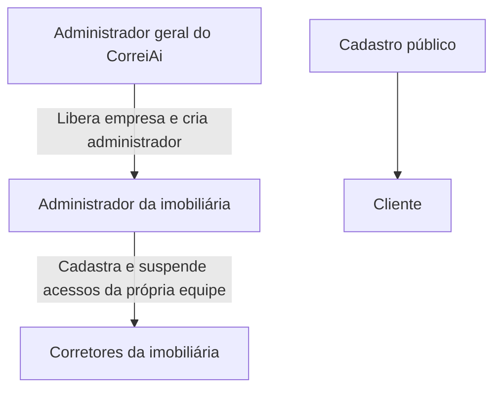

# Acesso por imobiliária

O CorreiAi tem três níveis profissionais. Clientes se cadastram pelo site; equipes recebem acesso pelo administrador responsável.

## Como usar

1. Entrar no login normal com uma conta `super_admin`. Ela abre `/admin/imobiliarias`.
2. Clicar em **Nova imobiliária** e informar nome, CNPJ opcional, nome/e-mail do responsável e senha inicial.
3. A empresa e o administrador são criados na mesma transação. Se e-mail/CNPJ já existir, a operação falha inteira, sem empresa órfã.
4. O administrador da empresa entra pelo mesmo login e abre `/admin`, onde cadastra os corretores. Cada novo corretor herda a imobiliária do administrador; IDs e permissões enviados pelo navegador não substituem esse vínculo.
5. O administrador da empresa pode suspender/reativar seus corretores. Somente o administrador geral pode suspender/reativar uma imobiliária inteira. A suspensão preserva dados e bloqueia também sessões já abertas.

O cadastro público `/cadastro` cria exclusivamente `lead` (cliente). Tentativas diretas de criar corretor, administrador de empresa ou administrador geral retornam 403. O cliente não pode informar a própria imobiliária. Não há promoção de usuários pela imobiliária.

## Administrador inicial

A conta existente indicada por Gabriel foi promovida a administrador geral por operação administrativa específica no Supabase, sem trocar sua senha. A migration não contém e-mail fixo, senha padrão ou promoção automática. Para provisionar outro administrador geral no futuro, exigir identificação e autorização explícitas do responsável pelo CorreiAi.

## Contas antigas

Corretores e administradores de empresa sem `imobiliaria_id` válido não têm acesso profissional. Os registros foram preservados para regularização administrativa; não atribuir uma empresa por suposição. A lista de empresas começa vazia até que o administrador geral libere a primeira empresa real.

Os imóveis antigos sem autoria continuam ocultos conforme [isolamento de dados](seguranca-dados.md). Contas de cliente criadas no site começam sem vínculo de imobiliária e sem acesso a catálogos privados.

## Banco e autorização

Migration: `20261029032636_brokerage_account_hierarchy.sql`. Adiciona situação, CNPJ e autoria da empresa, autoria dos perfis e RPC transacional `provisionar_imobiliaria`. A RPC é `SECURITY INVOKER`, com `search_path` vazio, execução exclusiva de `service_role` e verificação do administrador geral ativo. Perfis, imóveis, leads e imobiliárias permanecem privados para o SDK público.

API, sessão e proxy consultam função/perfil e empresa ativos a cada requisição. A permissão gravada no JWT não concede direitos antigos após suspensão ou mudança de função. O administrador geral administra empresas; a gestão de corretores exige administrador vinculado à própria empresa.

## Validação

`npm test` cobre cadastro público restrito, hierarquia de permissões, empresa ativa, falsificação de vínculo, isolamento da equipe e RPC de provisionamento. O teste SQL de duplicidade confirmou rollback sem empresa órfã e que `anon`/`authenticated` não executam a RPC.

Para a validação real autorizada: `node --env-file=.env.local scripts/validate-account-hierarchy.mjs --admin-id=<id verificado do administrador geral> --allow-production-fixtures`. O script usa o `JWT_SECRET` local somente para a sessão técnica do administrador já existente; não imprime tokens ou senhas. Cria empresas e corretores com marcadores exclusivos, valida a hierarquia e suspende os acessos técnicos ao final. Registra IDs para limpeza administrativa de clientes de teste em `.git/validation/account-hierarchy-production.json`.

O script anterior `validate-catalog-isolation.mjs` registrava corretores publicamente e corresponde ao contrato antigo. Usar o teste de hierarquia para o fluxo atual.

## Resultado em 29/10/2026

- Código na main em `455a7ab`; deploy `dpl_GxKE8PmjCW7naDZQSfBtF6fVgRbM`, READY no domínio público.
- 125 testes automatizados passaram; TypeScript, build de 30 rotas e ESLint dos arquivos alterados passaram. O build local utilizou chave pública fictícia somente para prerender; a integração real foi conferida separadamente no domínio publicado.
- 47 checks reais passaram: cadastro público restrito a cliente; criação de duas imobiliárias com administradores; criação de três corretores; equipe e imóveis isolados; colega da mesma empresa vê o imóvel; outra empresa não vê/edita/recomenda; suspensão e reativação de corretor e empresa; JWT antigo bloqueado após suspensão.
- O login da conta indicada por Gabriel abriu `/admin/imobiliarias` no Chrome, sem alteração de senha.
- Após o teste, foram removidos por IDs, e-mails e marcadores exclusivos os seis perfis técnicos e as duas empresas técnicas. O imóvel técnico também foi removido. Consulta final confirmou zero fixtures restantes e preservação dos três imóveis antigos.
- O painel está vazio, pronto para o administrador geral cadastrar a primeira imobiliária real. Os profissionais antigos sem vínculo permanecem preservados e sem acesso até regularização administrativa.

Evidências locais sem credenciais: `.git/validation/hierarchy-tests.log`, `hierarchy-lint.log`, `hierarchy-build.log`, `hierarchy-vercel-build.log`, `hierarchy-production-tests.log` e `account-hierarchy-production.json`.
