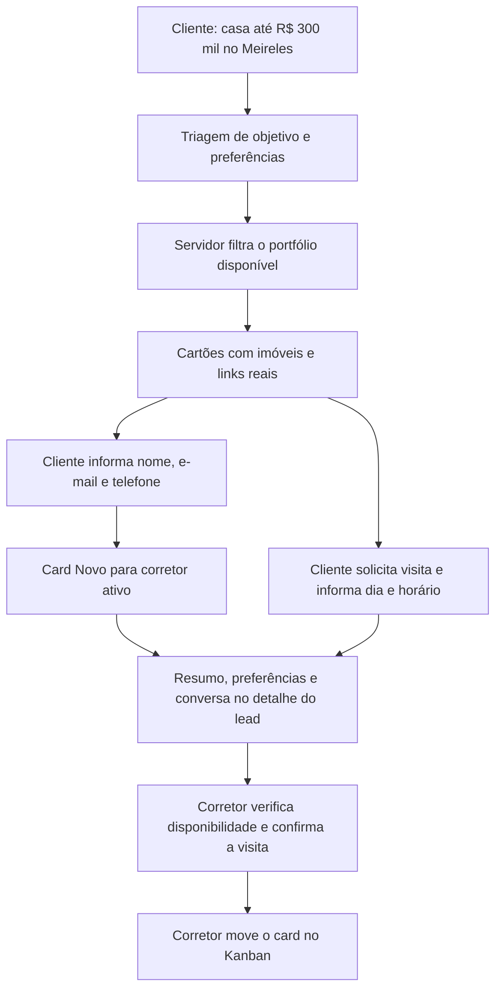

# Assistente imobiliário e triagem

O mesmo componente atende em `/assistente` e no dashboard do perfil lead. O assistente consulta os imóveis públicos e o próprio atendimento do visitante. Não há integração com Gmail: o pedido foi esclarecido como acesso aos imóveis e às informações do sistema.

## Exemplo de atendimento



O cadastro completo cria um card por conversa. Mensagens posteriores atualizam esse mesmo card; nunca alteram automaticamente `etapa` ou `corretor_id`. O Kanban atualiza ao recuperar o foco e a cada 20 segundos enquanto a página estiver visível.

## Conversa, dúvidas e objeções

O prompt orienta a responder à dúvida antes de avançar na triagem, acolher receios e comparar alternativas sem pressionar ou prometer descontos. Há orientação específica para saudação, indecisão, primeiro imóvel, objeção de preço, comparação, financiamento, frustração, pausa e proprietário interessado em vender.

A comparação geral entre casa e apartamento usa uma resposta factual do servidor, adaptada quando a pergunta menciona trabalho em casa. Isso evita afirmações de que toda casa é independente, dispensa condomínio ou permite pets sem regras. As demais respostas combinam o modelo, os dados do atendimento e as proteções descritas abaixo.

| Exemplo de fala do cliente | Comportamento esperado |
| --- | --- |
| “350 mil”, depois de uma pergunta sobre orçamento | Interpreta R$ 350.000 usando o contexto da pergunta |
| “Quero comprar apartamento, não alugar casa” | Mantém compra e apartamento; ignora as opções negadas |
| “Qual a diferença entre casa e apartamento?” | Explica diferenças sem trocar automaticamente a preferência já informada |
| “Está caro e tenho medo de me apertar” | Acolhe a preocupação e discute rever critérios, preservando o teto |
| “Não quero passar dados”, seguido de uma dúvida | Responde à nova dúvida sem insistir no cadastro |
| “Tem elevador, aceita pet e qual o condomínio?” | Esclarece todos os itens ausentes do cadastro do imóvel selecionado |
| “Obrigado, vou pensar” | Respeita a pausa e deixa o canal aberto |

Respostas longas são reduzidas a frases completas, preservando uma pergunta final curta quando houver, com no máximo 130 palavras e 1.800 caracteres. Isso evita que uma resposta do provider ultrapasse os 2.000 caracteres aceitos por mensagem na API e invalide o próximo turno. Valores recusados não ampliam o orçamento. Perguntas de comparação e indecisão não viram escolhas definitivas. A interpretação cobre padrões testados em português; linguagem ambígua pode exigir confirmação.

## Qualificação e imóveis

- Objetivo: comprar, alugar, investir ou anunciar/vender.
- Tipo, bairro, teto de orçamento, mínimo de quartos/vagas, prazo, forma de pagamento e características desejadas.
- Nome, e-mail e telefone são pedidos quando o cliente quer prosseguir. Recusa de cadastro/contato impede a criação; em atendimento já existente, a preferência fica sinalizada para o corretor.
- Uma solicitação de visita pode indicar imóvel real e preferência de dia/horário. A interface informa que o corretor ainda precisa confirmar.

Tipo, orçamento, quartos, vagas, contatos e recusa são interpretados no servidor. A extração de nome, bairro, prazo, pagamento e características pelo modelo só é aceita quando o valor consta literalmente nas falas do cliente; prazo também exige uma expressão temporal. A resposta recebe o estado atual da busca e somente os imóveis compatíveis.

A consulta considera até 500 imóveis disponíveis, ordenados por valor, e retorna até cinco compatíveis. Orçamento, tipo, bairro, quartos e vagas são filtros obrigatórios quando informados. Características descritivas, como varanda, dependem do conteúdo do cadastro e da conferência do corretor. Ausência de imóvel compatível e falha de consulta são situações distintas.

O catálogo atual não separa venda de locação nem possui preço de aluguel. Por isso, pedidos de aluguel são qualificados e encaminhados ao corretor, sem apresentar preço de venda como aluguel. Também não existe agenda de disponibilidade: a assistente registra pedidos de visita, sem efetuar reservas ou confirmar horários.

## Persistência e acesso

A migration `20261020223347_add_assistant_qualification.sql` adiciona `leads.qualificacao` (JSONB) e `assistente_sessao_hash`, com índice único parcial por conversa. Não muda proprietários, etapas, registros antigos ou políticas de RLS. Foi aplicada no Supabase do CorreiAi; outros ambientes precisam recebê-la antes da atualização do aplicativo. É possível voltar ao código anterior mantendo essas colunas opcionais, sem apagar o histórico coletado.

O visitante recebe um token aleatório em cookie `httpOnly`, `SameSite=Strict`, `Secure` em produção, válido por sete dias. Somente seu SHA-256 é persistido. O token permite recuperar o próprio atendimento, sem usar e-mail como autorização para ler ou atualizar outra conversa. O hash e os IDs internos do responsável não são enviados nas respostas do chat.

O corretor acessa apenas os leads permitidos pela API autenticada. A listagem traz o resumo; o detalhe inclui as últimas 30 mensagens. Leitura anônima direta de leads continua bloqueada no Supabase. O contexto próprio e os imóveis compatíveis são enviados ao OpenRouter para gerar a resposta; a chave permanece no servidor.

Antes de completar o contato, a conversa fica na sessão do navegador. Depois da captura, o histórico também pode ser recuperado pelo cookie. “Nova conversa” limpa a conversa local e o cookie, preservando o registro já encaminhado ao corretor. Logout também limpa esse contexto local.

## Modelo e falhas

Cada turno utiliza até duas chamadas ao modelo configurado: extração e resposta. O padrão é `mistralai/mistral-nemo`, com prioridade ao menor preço e teto de US$ 0,03 por milhão de tokens de entrada e saída. Esse teto não é um limite de gasto mensal. Nenhum outro modelo é selecionado automaticamente.

Histórico inválido e origem externa são recusados antes do provider. Timeout e HTTP 429 preservam a mensagem para nova tentativa. Se só a geração da resposta falhar, uma resposta local orienta o próximo passo e mostra um aviso. Falha de gravação nunca produz status de cadastro confirmado. Há proteções para alegações de visita confirmada ou cadastro concluído, convites após cancelamento explícito, recusa de contato e anúncios de opções quando o portfólio filtrado está vazio. A confirmação de gravação vem do aplicativo. Essas verificações e o prompt reduzem erros conhecidos; respostas do modelo ainda exigem acompanhamento.

## Testes

```powershell
npm test
npm run build

# Com o servidor local iniciado; cria fixtures e faz chamadas pagas pequenas ao NeMo.
$env:CORREIAI_RUN_ASSISTANT_TESTS = '1'
node scripts/validate-assistant-integration.mjs

# Cenários de conversa real: 12 situações, com saudações, objeções e continuidade.
$env:CORREIAI_RUN_CONVERSATION_TESTS = '1'
node scripts/validate-assistant-conversations.mjs

# Regressão de cadastro/login, upload, imóveis, leads, permissões e Kanban.
$env:CORREIAI_RUN_REAL_TESTS = '1'
node scripts/validate-real-integration.mjs
```

Os scripts aceitam somente localhost/127.0.0.1 e conferem o projeto Supabase antes de criar registros temporários. A limpeza usa IDs e marcadores exclusivos e confere a ausência dos registros ao terminar. Relatórios ficam no diretório retornado por `git rev-parse --git-path validation`, fora do versionamento. O teste do assistente confere a conversa real, extração, portfólio, persistência, isolamento, mudanças de preferências, recusa de contato, solicitação de visita e preservação da etapa/responsável.

O teste de conversas usa critérios explícitos sobre comportamento, fatos e tamanho das respostas; as respostas também foram lidas para identificar problemas que esses critérios não capturavam. Os checks não são uma medição geral da inteligência do modelo nem garantia para toda conversa futura.

A validação visual desta atualização está pendente: o controle de navegador recusou o acesso à aba. Testes HTTP e de banco não substituem essa conferência.
